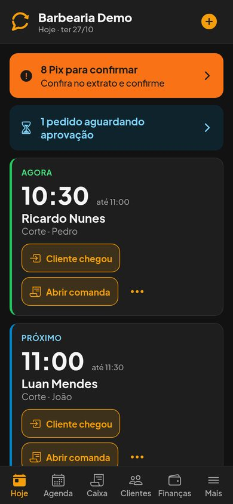
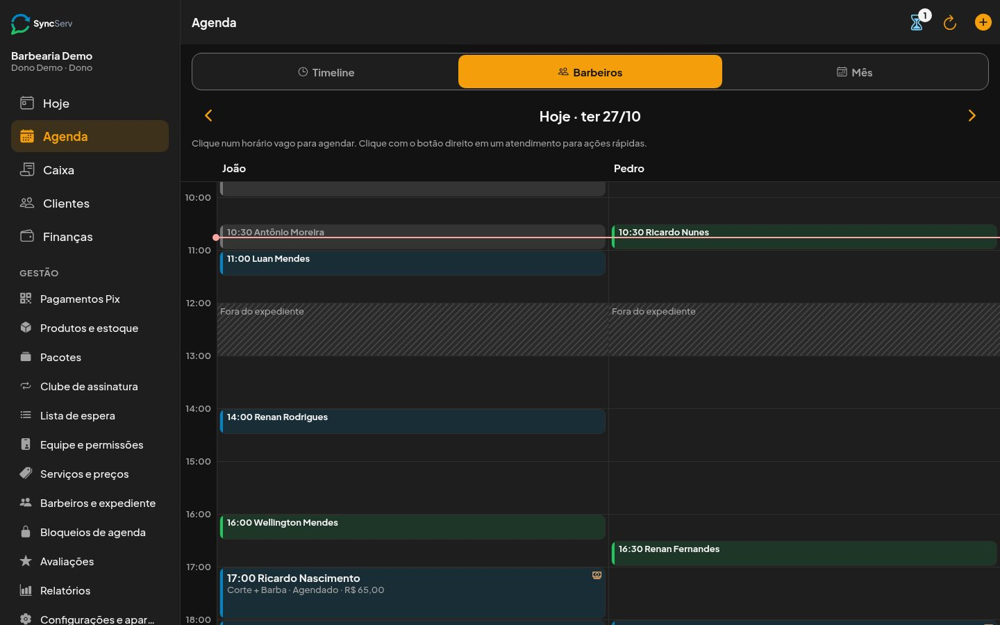
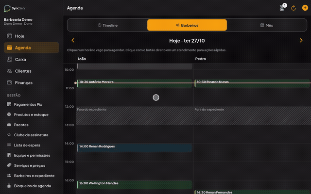
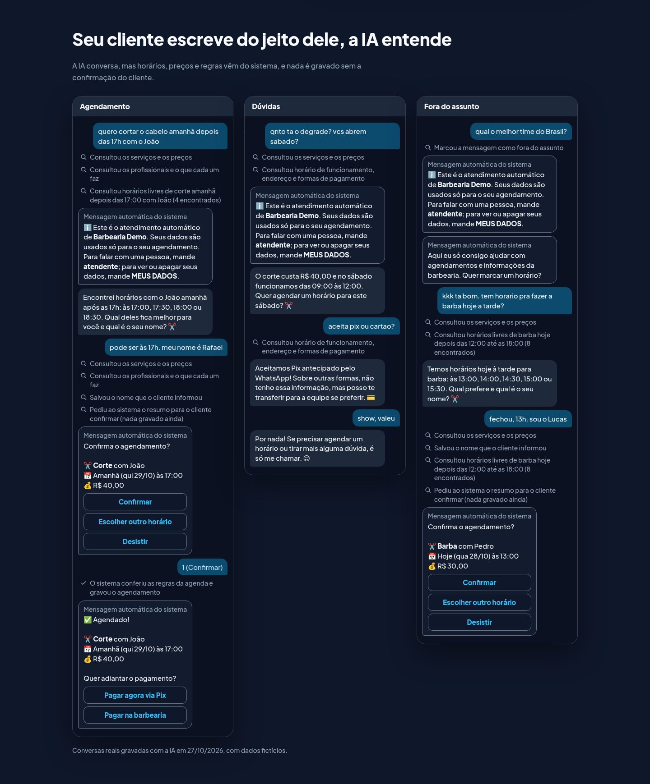

# SyncServ

Agendamento pelo WhatsApp com IA e gestão completa (agenda, comanda, estoque e Pix) para negócios de serviço.
Projeto pessoal de portfólio de Matheus Souza; o **Klipper** é a versão para barbearias.

**Site:** https://souzza-matheus.github.io/klipper-site/

  
  
  

### O app funcionando

Vídeo completo (agendamento rápido e fechamento da comanda): [MP4](assets/app/app.mp4) · [WebM](assets/app/app.webm).
As capturas e o vídeo mostram o app de verdade com dados fictícios.

### Atendimento com IA

Conversas reais gravadas com a IA em 27/10/2026, com dados fictícios. A IA conversa, mas
horários, preços e regras vêm do sistema, e nada é gravado sem a confirmação do cliente. No site o exemplo é estático:
não há campo de texto nem chamada a servidor.

## Principais funções

- Bot no WhatsApp com IA (opcional) e menu numerado: agenda, cancela, remarca, lembra o horário e cobra o Pix
- Agenda por dia, por profissional e por mês, com agendamento rápido
- Comanda e caixa com pagamento dividido, desconto e gorjeta
- Estoque com baixa automática, pacotes e clube de assinatura
- Pix pela chave do negócio, com leitura e conferência do comprovante
- App que funciona sem internet no celular e versão web para a recepção
- Multi-tenant: vários negócios, cada um com a sua equipe e os seus papéis (dono, recepção, profissional)

## Stack

FastAPI · PostgreSQL · SQLAlchemy · React Native com Expo e react-native-web · Evolution API · Gemini · Docker · Caddy

## Destaques técnicos

- **Sincronização offline:** banco local criptografado (SQLCipher), fila de operações com idempotência, versão por registro e resolução de conflitos.
- **Isolamento entre negócios:** cada consulta é limitada ao negócio e ao papel de quem pede, com testes que tentam ler dados de outro negócio.
- **Testes de segurança:** isolamento, injeção, validação de entrada, abuso, sessões com 2FA e refresh token rotativo, webhooks e varredura de segredos.
- **Acessibilidade WCAG 2.2 AA:** contraste, alvos de toque de 48 px, leitor de tela e teclado, conferidos com axe e Lighthouse.

**Código-fonte privado; demonstração mediante solicitação.**

Repositório: https://github.com/souzza-matheus/klipper-site

## Contato

- E-mail: [matheus.ramirez019@gmail.com](mailto:matheus.ramirez019@gmail.com)
- WhatsApp: [wa.me/5531995887186](https://wa.me/5531995887186)
- LinkedIn: [matheus-souza-a07200200](https://www.linkedin.com/in/matheus-souza-a07200200/)

---

Este repositório guarda só os arquivos estáticos do site, gerados a partir do projeto privado, e o workflow que os
publica no GitHub Pages.
